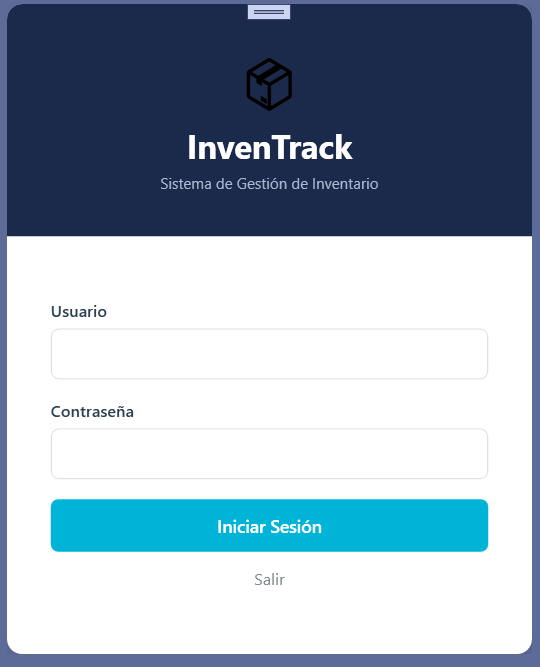
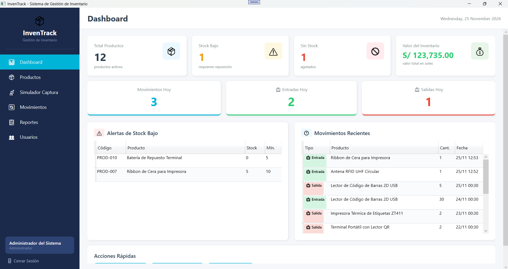
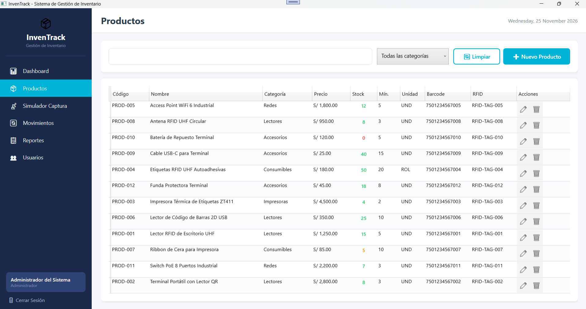
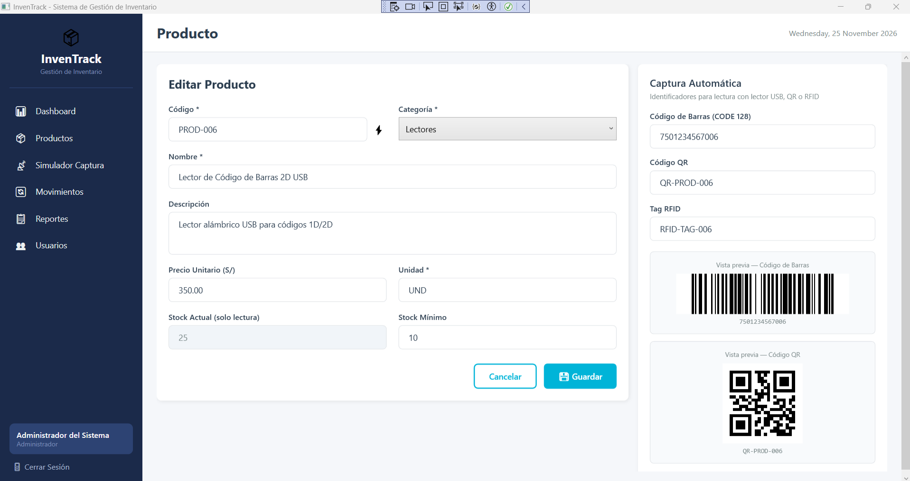
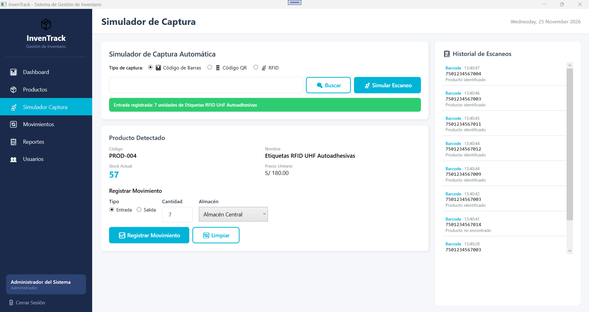
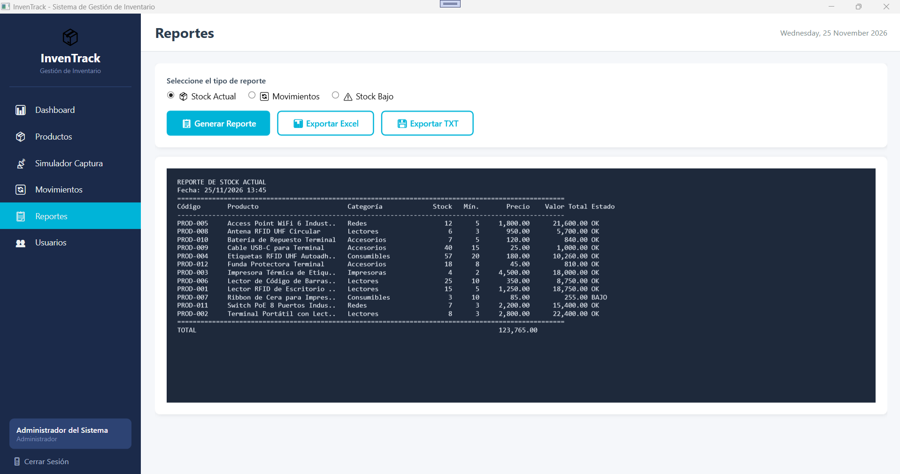
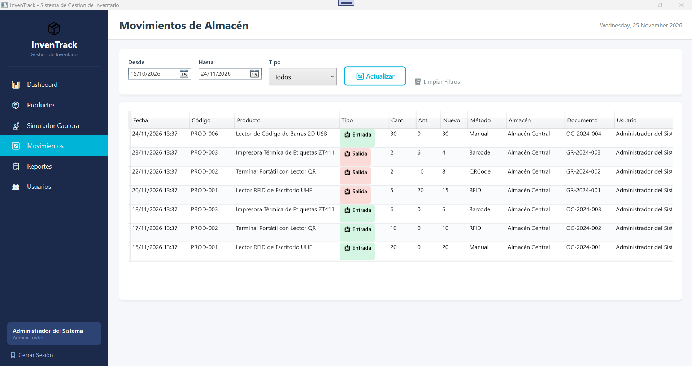
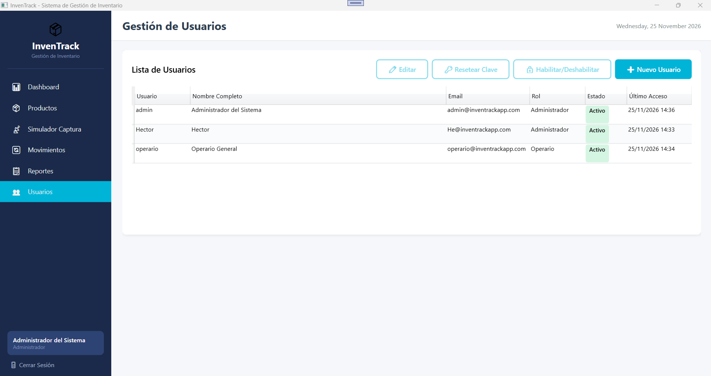
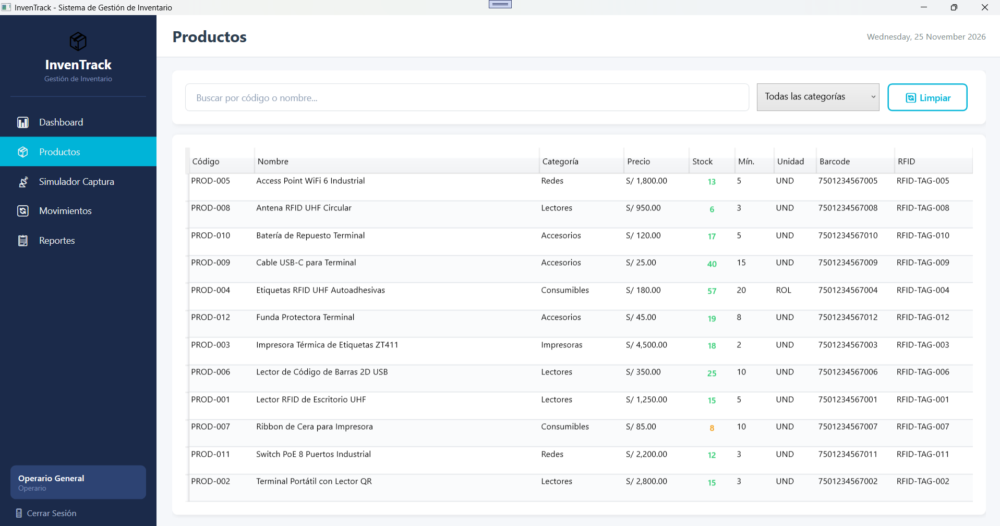

# InvenTrack

<div align="center">

**Sistema de Gestión de Inventario con Captura Automática (RFID / QR / Código de Barras)**

[](https://dotnet.microsoft.com/)
[](https://learn.microsoft.com/en-us/dotnet/desktop/wpf/)
[](https://www.microsoft.com/sql-server)
[](LICENSE)

</div>

---

## Descripción

Aplicación de escritorio desarrollada en **WPF (.NET 8)** con arquitectura **MVVM**, diseñada para la gestión integral de inventarios en entornos de comercio mayorista y minorista. Conecta directamente a **SQL Server** mediante autenticación integrada de Windows, con acceso a datos a través de stored procedures y el micro-ORM **Dapper**. Incluye un módulo de simulación de dispositivos de captura automática (RFID, QR, código de barras) preparado arquitectónicamente para la integración con hardware real, y generación visual de códigos de barras y QR en tiempo real con la librería **ZXing.Net**.

## Capturas de Pantalla

<div align="center">

| Login | Dashboard |
|:---:|:---:|
|  |  |

| Gestión de Productos | Formulario de Producto |
|:---:|:---:|
|  |  |

| Simulador de Captura | Reportes |
|:---:|:---:|
|  |  |

| Historial de Movimientos | Gestión de Usuarios |
|:---:|:---:|
|  |  |

<details>
<summary><strong>Vista de Operario (RBAC)</strong></summary>
<br>



*El rol Operario no tiene acceso al módulo de Usuarios ni a las acciones de crear/editar/eliminar productos.*

</details>

</div>

## Arquitectura

```
┌─────────────────────────────────────────────────────────────┐
│                      CAPA DE PRESENTACIÓN                   │
│  Views (XAML)  ◄──►  ViewModels (MVVM)  ◄──►  Converters  │
├─────────────────────────────────────────────────────────────┤
│                     CAPA DE SERVICIOS                       │
│  AuthenticationService │ ScannerSimulatorService            │
│  NavigationService     │ ReportService                      │
│  BarcodeGeneratorService (ZXing.Net)                        │
├─────────────────────────────────────────────────────────────┤
│                    CAPA DE DATOS                            │
│  Repositories (Dapper)  ◄──►  SQL Server (Stored Procs)    │
├─────────────────────────────────────────────────────────────┤
│                    BASE DE DATOS                            │
│  Tables │ Stored Procedures │ Views │ Triggers              │
└─────────────────────────────────────────────────────────────┘
```

## Stack Tecnológico

| Componente | Tecnología | Versión |
|---|---|---|
| Lenguaje | C# | 12 |
| Framework | .NET / WPF | 8.0 |
| Patrón | MVVM | — |
| Base de Datos | SQL Server | 2019+ |
| Micro ORM | Dapper | 2.1.35 |
| Hashing | BCrypt.Net-Next | 4.0.3 |
| Códigos de Barras | ZXing.Net | 0.16.9 |
| Exportación Excel | ClosedXML | 0.104.2 |

## Módulos

### Autenticación
Login seguro con hashing BCrypt y control de acceso por roles (Administrador / Operario). Gestión de usuarios con activación/desactivación de cuentas.

### Dashboard
Panel de control con 7 indicadores clave (KPI): total de productos, alertas de stock bajo, productos agotados, valor total del inventario, movimientos del día, entradas y salidas. Incluye tablas de alertas y movimientos recientes.

### Gestión de Productos
CRUD completo con categorías, precios, unidades de medida y campos de captura automática (código de barras, QR, tag RFID). Visualización en tiempo real de códigos de barras (CODE 128) y QR generados con ZXing.Net.

### Simulador de Captura
Simulación de lectura de dispositivos RFID, QR y código de barras. El campo de entrada manual es compatible con lectores USB reales (modo HID) que actúan como teclado. Arquitectura preparada para integración con SDKs de hardware (Zebra, Honeywell, Impinj).

### Movimientos de Almacén
Registro transaccional de entradas, salidas, transferencias y ajustes. Control de stock con validación de disponibilidad. Historial completo con trazabilidad de usuario, método de captura y documento de referencia.

### Reportes
Generación de reportes de stock actual, movimientos por período y alertas de stock bajo. Exportación a **Excel (.xlsx)** con formato profesional (encabezados, colores, bordes, fórmulas) y a texto plano (.txt).

### Gestión de Usuarios
Panel de administración de usuarios con creación de cuentas, asignación de roles, habilitación/deshabilitación de acceso y reseteo de contraseñas. Acceso exclusivo para el rol Administrador.

## Estructura del Proyecto

```
InvenTrack/
├── database/                 Scripts SQL
│   ├── 01_CreateDatabase.sql
│   ├── 02_CreateTables.sql      6 tablas con FK, CHECK, índices filtrados
│   ├── 03_StoredProcedures.sql  24 stored procedures
│   ├── 04_Views.sql             3 vistas
│   ├── 05_SeedData.sql          Datos de prueba con hashes BCrypt reales
│   └── 06_Triggers.sql          Trigger de auditoría de timestamps
├── docs/
│   ├── ER_Diagram.md            Diagrama Entidad-Relación
│   ├── DataDictionary.md        Diccionario de datos
│   └── UserManual.md            Manual de usuario
└── src/InvenTrack/InvenTrack/
    ├── Core/                    Infraestructura MVVM (ViewModelBase, RelayCommand, Mediator)
    ├── Models/                  Entidades del dominio
    ├── Data/                    Repositorios con Dapper + Stored Procedures
    ├── Services/                Lógica de negocio y servicios
    ├── ViewModels/              ViewModels con binding bidireccional
    ├── Views/                   Interfaces XAML
    ├── Converters/              Value Converters (BoolToVisibility, StockLevelToColor)
    └── Themes/                  Sistema de temas (Colors, Styles)
```

## Requisitos Previos

- [.NET 8 SDK](https://dotnet.microsoft.com/download/dotnet/8.0)
- [SQL Server 2019+](https://www.microsoft.com/sql-server) (Express, Developer o Standard)
- [SQL Server Management Studio (SSMS)](https://learn.microsoft.com/sql/ssms/download-sql-server-management-studio-ssms)
- [Visual Studio 2022+](https://visualstudio.microsoft.com/) con carga de trabajo "Desarrollo de escritorio .NET"

## Instalación y Ejecución

### 1. Clonar el repositorio

```bash
git clone https://github.com/hectorpalaciosromero/InvenTrack.git
cd InvenTrack
```

### 2. Crear la base de datos en SQL Server

Abrir **SSMS**, conectarse a `localhost` y ejecutar los scripts en orden:

```
database\01_CreateDatabase.sql
database\02_CreateTables.sql
database\03_StoredProcedures.sql
database\04_Views.sql
database\05_SeedData.sql
database\06_Triggers.sql
```

O desde la terminal con `sqlcmd` (el flag `-x` es necesario porque los hashes BCrypt contienen caracteres `$`):

```powershell
sqlcmd -S localhost -x -f 65001 -i "database\01_CreateDatabase.sql"
sqlcmd -S localhost -x -f 65001 -i "database\02_CreateTables.sql"
sqlcmd -S localhost -x -f 65001 -i "database\03_StoredProcedures.sql"
sqlcmd -S localhost -x -f 65001 -i "database\04_Views.sql"
sqlcmd -S localhost -x -f 65001 -i "database\05_SeedData.sql"
sqlcmd -S localhost -x -f 65001 -i "database\06_Triggers.sql"
```

### 3. Verificar la base de datos

```powershell
sqlcmd -S localhost -d InvenTrackDB -Q "SELECT Username, Role FROM Users; SELECT COUNT(*) AS Productos FROM Products;"
```

### 4. Compilar y ejecutar

```bash
dotnet build InvenTrack.sln
dotnet run --project src/InvenTrack/InvenTrack
```

O abrir `InvenTrack.sln` en Visual Studio y presionar **F5**.

### Configuración de conexión

La cadena de conexión se configura en `src/InvenTrack/InvenTrack/appsettings.json`:

```json
{
  "ConnectionStrings": {
    "InvenTrack": "Server=localhost;Database=InvenTrackDB;Trusted_Connection=True;TrustServerCertificate=True;"
  }
}
```

> `Trusted_Connection=True` utiliza autenticación integrada de Windows, sin necesidad de almacenar credenciales. Para instancias con nombre, usar `Server=localhost\\SQLEXPRESS` o `Server=.\\NOMBRE_INSTANCIA`.

## Usuarios por Defecto

| Usuario | Contraseña | Rol | Acceso |
|---|---|---|---|
| `admin` | `Admin123!` | Administrador | Acceso total a todos los módulos |
| `operario` | `Oper123!` | Operario | Dashboard, Productos (lectura), Escáner, Movimientos, Reportes |

## Base de Datos

### Modelo Relacional

- **Users**: Autenticación y control de acceso con BCrypt
- **Categories**: Clasificación de productos
- **Products**: Catálogo con campos de captura automática (Barcode, QR, RFID)
- **Warehouses**: Ubicaciones físicas de almacenamiento
- **StockMovements**: Registro transaccional de movimientos de inventario
- **ScanEvents**: Bitácora de eventos de escaneo para auditoría

### Stored Procedures (24)

Toda la lógica de acceso a datos se ejecuta mediante stored procedures, incluyendo `sp_CreateStockMovement` con transacciones explícitas para garantizar la integridad del stock.

## Características Técnicas

- **MVVM puro** con `ViewModelBase`, `RelayCommand` y sistema `Mediator` pub/sub
- **Dapper** como micro-ORM para máximo rendimiento en consultas
- **BCrypt** con factor de costo 11 para hashing de contraseñas
- **ZXing.Net** para generación de códigos de barras (CODE 128) y QR en tiempo real
- **ClosedXML** para exportación de reportes Excel con formato profesional
- **Transacciones SQL** en movimientos de stock con validación de disponibilidad
- **Triggers** para auditoría automática de timestamps
- **Vistas SQL** para consultas de dashboard optimizadas
- **Patrón Singleton** en servicios de autenticación y navegación
- **IDisposable** en ViewModels con limpieza de suscripciones Mediator
- Compatible con **lectores USB de código de barras** (modo HID) sin configuración adicional
- **Cadena de conexión externalizada** en `appsettings.json` con soporte para múltiples entornos

## Despliegue en Producción

Para apuntar a un servidor SQL Server en red, solo se requiere modificar `appsettings.json`:

```json
{
  "ConnectionStrings": {
    "InvenTrack": "Server=192.168.1.100;Database=InvenTrackDB;Trusted_Connection=True;TrustServerCertificate=True;"
  }
}
```

No se requieren cambios en el código fuente. La arquitectura separa completamente la configuración de conexión de la lógica de acceso a datos.

## Licencia

Este proyecto está bajo la [Licencia MIT](LICENSE). Desarrollado por **Héctor Palacios Romero**.
